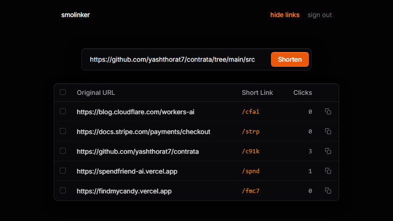

# 🔗 Smolinker

<p align="center">
  
</p>

A minimalist, high-speed URL shortener with comprehensive client telemetry and analytics.  
**Smolinker** pairs instant 4-character base-36 link shortening with real-time visitor intelligence, all powered by React 19, Tailwind CSS v4, and Neon Serverless PostgreSQL.

[](https://react.dev/)
[](https://vite.dev/)
[](https://tailwindcss.com/)
[](https://neon.tech/)
[](https://reactrouter.com/)

---

## ✨ Features & Highlights

### ⚡ Rapid Link Shortening
- **Base-36 Hash Generation**: Automatically transforms any long URL into an ultra-compact 4-character slug (e.g., `/c91k`) for clean sharing.
- **Custom Vanity Slugs**: Support for optional personalized slugs to maintain brand identity.
- **One-Click Clipboard Copy**: Seamless copy action with inline feedback animations and automatic field selection.
- **Fast Client-Side Validation**: Immediate protocol inspection and whitespace sanitization prior to database commits.

### 📊 Deep Telemetry & Click Analytics
- **Visitor Fingerprinting**: Captures comprehensive, privacy-conscious visitor signals upon redirection:
  - **Device & Hardware**: Screen width/height, device type (Desktop, Mobile, Tablet), touch capabilities.
  - **Environment**: Operating system & version, browser engine & version, primary language, user agent.
  - **Network & Geo**: Country, region, city, ISP, timezone, and geolocation coordinates.
  - **Traffic Origin**: HTTP referrer detection to track where inbound clicks originate.
- **Visual Analytics Dashboard**: Interactive modal (`ClickStats`) displaying:
  - Activity timeline bar chart grouped by date.
  - Device breakdown percentages.
  - Top geographic origins.
  - Browser distribution metrics.

### 🗃️ Comprehensive Link Management
- **Interactive Data Table**: View all shortened links with original destination URLs, short slugs, click tallies, and creation dates.
- **Inline URL Editing**: Update the destination URL of existing links on the fly without changing the shortened slug.
- **Bulk & Single Deletions**: Select individual links or use batch selection with one-click multi-row deletions.
- **Full Row Inspection**: Click any row to slide open its deep telemetry breakdown and granular audit log.

### 🔐 Secure Architecture & Isolated Profiles
- **User Authentication**: Account sign-up and sign-in backed by bcrypt password hashing.
- **Strict Data Isolation**: Queries filter exclusively by authenticated user IDs, ensuring complete privacy.
- **Serverless PostgreSQL**: Instant cold starts and query scalability backed by `@neondatabase/serverless` connection pooling.

### 🎨 Minimal Dark Aesthetic
- **Zinc & Dark Palette**: High-contrast, distraction-free interface built on a `#09090c` backdrop with vibrant orange accent tones.
- **Keyboard-First Workflow**: Auto-shortening buffer preserves pending URLs across authentication hops.

---

## 🛠 Tech Stack

### Frontend
- **Framework**: React 19 (Hooks, Suspense, Concurrent rendering)
- **Build Tool**: Vite 7 (Lightning-fast HMR and Rollup bundling)
- **Styling**: Tailwind CSS v4 (`@tailwindcss/vite` modern CSS pipeline)
- **Routing**: React Router v7 (Data routers, dynamic parameter routing)
- **Typography & Icons**: Lucide-inspired SVG primitives and responsive font tokens

### Backend & Database
- **Database**: Neon (Serverless PostgreSQL over WebSockets/HTTPS)
- **Database Driver**: `@neondatabase/serverless` with connection pooling
- **Security**: Client-side password hashing and salted verification routines

### Tooling & Quality
- **Linter**: ESLint 9 (`@eslint/js`, React Hooks, React Refresh)
- **Formatter**: Prettier 3 with `prettier-plugin-tailwindcss`

---

## 📂 Directory Structure

```text
🌟 smolinker/
├── 📁 migrations/                 # PostgreSQL schema migrations
│   ├── 001_expand_clicks.sql      # Clicks telemetry columns & indices
│   └── run.js                     # Migration execution script
│
├── 📁 public/                     # Static icons and assets
│   ├── check.svg                  # Completed state indicator
│   ├── copied.svg                 # Clipboard copy confirmation icon
│   └── favicon.svg                # Application branding icon
│
├── 📁 src/                        # Application source code
│   ├── 📁 components/             # Reusable UI & domain components
│   │   ├── auth-box.jsx           # Sign-in & registration card
│   │   ├── ClickStats.jsx         # Analytics charts & device breakdown
│   │   ├── LinkModal.jsx          # URL inspection & telemetry modal
│   │   ├── LinkTable.jsx          # Batch-selectable link data table
│   │   ├── protected-route.jsx    # Authentication route guard
│   │   └── 📁 ui/                 # UI primitives (Button, Checkbox, Input, Modal)
│   │
│   ├── 📁 context/
│   │   └── auth-context.jsx       # Auth provider & persistent user state
│   │
│   ├── 📁 hooks/
│   │   ├── use-fetch.jsx          # Declarative data fetching hook
│   │   └── useLinks.js            # URL CRUD, batch selection, and modal state
│   │
│   ├── 📁 layouts/
│   │   └── app-layout.jsx         # Global shell with navigation header
│   │
│   ├── 📁 pages/
│   │   ├── auth.jsx               # Authentication view
│   │   ├── landing.jsx            # Main shortener input & link dashboard
│   │   └── redirect-link.jsx      # Dynamic resolver & telemetry collector
│   │
│   ├── 📁 services/
│   │   ├── authService.js         # User registration & verification queries
│   │   ├── clickService.js        # Click telemetry persistence & queries
│   │   ├── db.js                  # Neon serverless client initialization
│   │   ├── fingerprint.js         # Client environment & device telemetry collector
│   │   └── linkService.js         # URL generation, retrieval, and deletion queries
│   │
│   ├── App.jsx                    # Top-level routing layout
│   ├── index.css                  # Global styles & animation utilities
│   └── main.jsx                   # React root mount point
│
├── .env                           # Environment configuration
├── .gitignore                     # Git ignore definitions
├── components.json                # Component configuration
├── eslint.config.js               # ESLint configuration rules
├── index.html                     # HTML document shell
├── package.json                   # Project scripts and dependencies
├── README-img.png                 # Interface preview screenshot
├── README.md                      # Project documentation
├── vercel.json                    # Edge routing & deployment configuration
└── vite.config.js                 # Vite bundler & plugin setup
```

---

## 📄 Getting Started

Follow these steps to set up and run Smolinker locally:

### 1️⃣ Clone the Repository
```bash
git clone https://github.com/yashthorat7/smolinker.git
cd smolinker
```

### 2️⃣ Install Dependencies
```bash
npm install
```

### 3️⃣ Configure Environment Variables
Create a `.env` file in the root directory:
```env
# Neon Serverless PostgreSQL Connection String
VITE_NEON_DATABASE_URL="postgresql://[user]:[password]@[host]/[dbname]?sslmode=require"

# Base URL for generated links (e.g. http://localhost:5173 for local dev)
VITE_WEBSITE_URL="http://localhost:5173"
```

### 4️⃣ Run Database Migrations
Initialize the necessary PostgreSQL tables (`users`, `urls`, `clicks`):
```bash
node migrations/run.js
```

### 5️⃣ Start the Development Server
```bash
npm run dev
```

Open `http://localhost:5173` in your browser to start shortening links!

---

## 🛠️ How It Works

1. **Shorten**: Paste any HTTP/HTTPS URL into the central input field and click **Shorten**.
2. **Copy & Share**: Copy the concise 4-character link (e.g., `smolinker.app/c91k`) to your clipboard.
3. **Redirect & Capture**: When a visitor follows the link, `redirect-link.jsx` logs browser and device metrics asynchronously before executing an instant redirect.
4. **Analyze**: Open the **links** view and click any row to inspect click timelines, device proportions, and geographic distributions.

---

## 📡 Database Architecture

### `urls` Table
| Column | Type | Description |
|---|---|---|
| `id` | `SERIAL PRIMARY KEY` | Unique record identifier |
| `title` | `TEXT` | Link description or original URL |
| `original_url` | `TEXT NOT NULL` | Target redirect destination |
| `short_url` | `VARCHAR(14) NOT NULL` | Generated unique base-36 slug |
| `custom_url` | `VARCHAR(259)` | Optional vanity slug |
| `user_id` | `INTEGER REFERENCES users(id)` | Associated owner account |
| `created_at` | `TIMESTAMP DEFAULT NOW()` | Record timestamp |

### `clicks` Table
| Column | Type | Description |
|---|---|---|
| `id` | `SERIAL PRIMARY KEY` | Unique click event identifier |
| `url_id` | `INTEGER REFERENCES urls(id)` | Associated shortened link |
| `device_type` | `TEXT` | Desktop, Mobile, or Tablet |
| `browser` | `TEXT` | Browser name (Chrome, Safari, Firefox, Edge) |
| `os` | `TEXT` | Operating system (macOS, Windows, iOS, Android, Linux) |
| `country` | `TEXT` | Country name |
| `city` | `TEXT` | City name |
| `ip_address` | `TEXT` | Remote IP address |
| `referrer` | `TEXT` | Inbound traffic source |
| `created_at` | `TIMESTAMP DEFAULT NOW()` | Timestamp of the click |

---

## ❤️ Developed By

👨‍💻 **Yash Thorat**  
Feel free to suggest improvements, or report issues!

⭐ Don't forget to **star** this repository if you find it useful!
